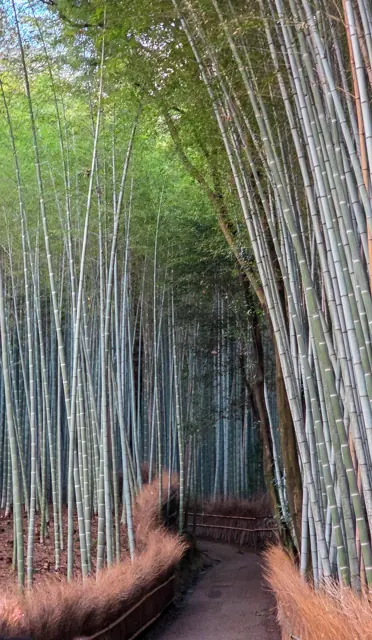
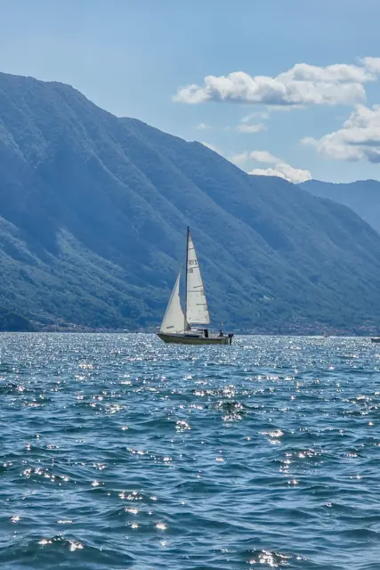
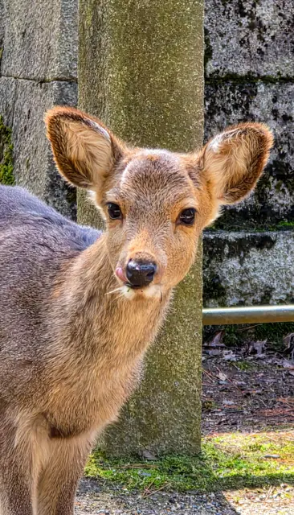

# Ignacio Estevo

A glimpse into what I'm working on, things I'm exploring, and life through my camera.

[GitHub](https://github.com/NachoEstevo) · [LinkedIn](https://www.linkedin.com/in/ignacio-estevo/) · [Photography](https://www.pexels.com/@nachoestevo/) · [X](https://x.com/Nachoestevo)

I'm Nacho. I build products, try out ideas, and take photos along the way.

This is where I bring those things together: projects I'm working on, experiments, places I've been, and whatever comes next. Some things are finished, others are still taking shape. So is this site.
